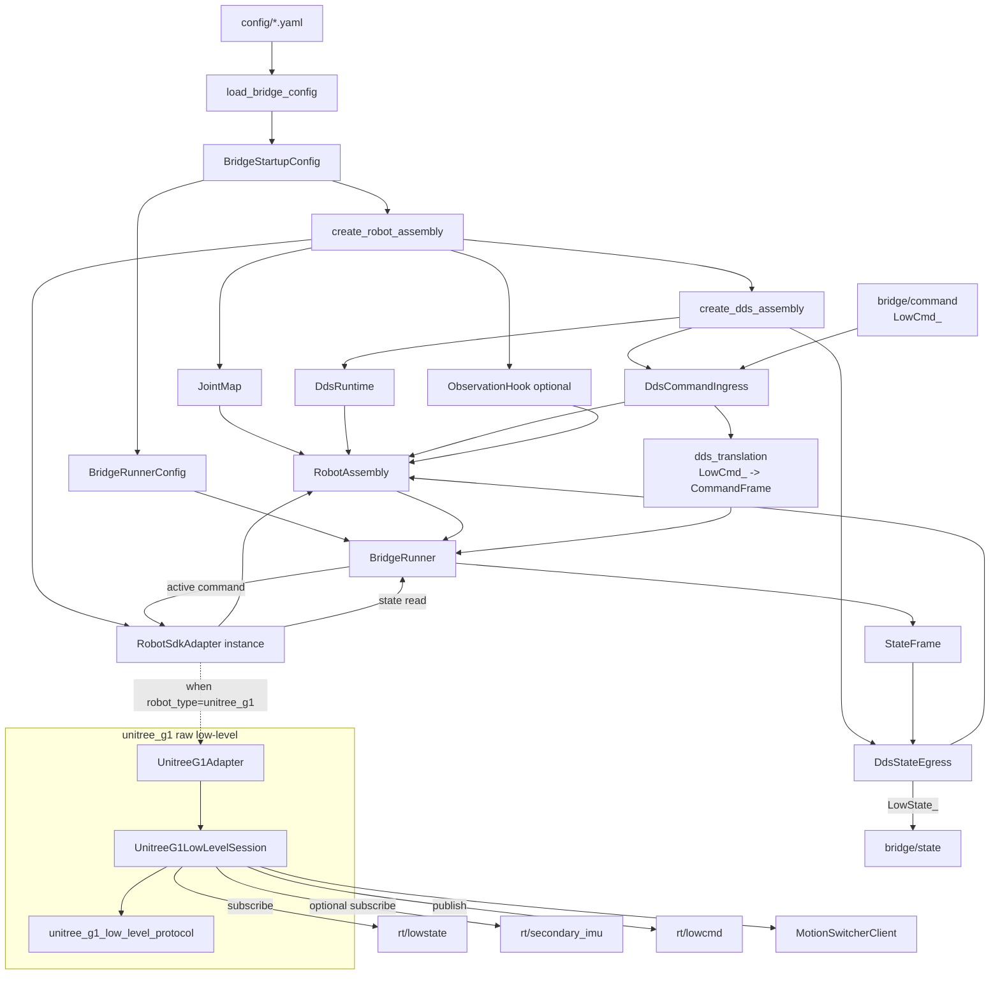

# Adapter Bridge 运行时结构

这份文档描述当前 `adapter_bridge` 的运行时结构，重点覆盖：

- 配置加载到 `BridgeStartupConfig` 的路径
- `RobotAssembly` 的组装方式
- `BridgeRunner` 的主循环职责
- bridge-facing DDS 与 robot-facing DDS 的分层
- `unitree_g1` raw low-level 的 adapter / session / protocol 分工

## 总体结构图

## 分层说明

### 1. 配置层

- 配置文件先经由 `load_bridge_config(...)` 加载。
- 文本内容先进入 `RawBridgeConfig`，再通过 `finalize_config(...)` 归一化为 `BridgeStartupConfig`。
- 运行时真正使用的是 `BridgeStartupConfig`，而不是原始文本字段的直接映射。

关键文件：

- `src/bridge/config/bridge_config.cpp`
- `include/bridge/config/bridge_config.hpp`

### 2. 组装层

- `create_robot_assembly(...)` 根据 `startup_config.robot_type` 选择具体机器人分支。
- 每个分支负责：
  - 构造 `JointMap`
  - 构造具体 adapter
  - 构造 DDS runtime / ingress / egress
  - 最终合成 `RobotAssembly`

关键文件：

- `src/bridge/app/robot_assembly_factory.cpp`
- `include/bridge/app/robot_assembly_factory.hpp`

### 3. Runner 主循环层

- `BridgeRunner` 是唯一主循环拥有者。
- 每个周期大致做：
  1. adapter `read_state()`
  2. 发布 bridge-facing state
  3. `evaluate_health()`
  4. `apply_command_policy()` 决定发正常命令 / safe command / 什么都不发

关键文件：

- `src/bridge/core/bridge_runner.cpp`
- `include/bridge/core/bridge_runner.hpp`

### 4. bridge-facing DDS 层

- bridge 对外暴露：
  - `bridge/command`
  - `bridge/state`
- 当前对外消息类型仍然沿用 Unitree 的：
  - `LowCmd_`
  - `LowState_`
- 在 ingress/egress 边界转换为内部统一：
  - `CommandFrame`
  - `StateFrame`

关键文件：

- `src/bridge/dds/dds_command_ingress.cpp`
- `src/bridge/dds/dds_state_egress.cpp`
- `src/bridge/dds/dds_translation.cpp`

### 5. G1 raw low-level 层

`unitree_g1` 当前拆成三层：

#### `UnitreeG1Adapter`

- 对 `BridgeRunner` 暴露统一 `RobotSdkAdapter` 接口
- 负责把 session 结果包装成统一 `AdapterCallResult / StateFrame / AdapterHealth`

#### `UnitreeG1LowLevelSession`

- 持有 G1 raw low-level 会话的运行时上下文
- 负责：
  - `MotionSwitcherClient` 前置条件
  - `LowState_` / `IMUState_` 缓存
  - `LowCmd_` 发布
  - stale/degraded 健康语义
  - robot-facing topic 生命周期

#### `unitree_g1_low_level_protocol`

- 专门处理协议细节：
  - `LowCmd_` 打包
  - safe low-level packet
  - CRC 计算/校验

关键文件：

- `include/bridge/adapters/unitree_g1/unitree_g1_adapter.hpp`
- `src/bridge/adapters/unitree_g1/unitree_g1_adapter.cpp`
- `include/bridge/adapters/unitree_g1/unitree_g1_low_level_session.hpp`
- `src/bridge/adapters/unitree_g1/unitree_g1_low_level_session.cpp`
- `include/bridge/adapters/unitree_g1/unitree_g1_low_level_protocol.hpp`
- `src/bridge/adapters/unitree_g1/unitree_g1_low_level_protocol.cpp`

## 两层 DDS topic 的区别

### bridge-facing topic

配置来源：

- `config/g1.sample.yaml` 的 `dds.topics.*`

当前值：

- `bridge/command`
- `bridge/state`

作用：

- 外部系统与 `adapter_bridge` 通信

### robot-facing topic

当前 G1 内部使用：

- `rt/lowcmd`
- `rt/lowstate`
- `rt/secondary_imu`

作用：

- `UnitreeG1LowLevelSession` 与 G1 机器人本体通信

## 当前实现状态

当前 `unitree_g1` 已经具备：

- build / config / factory 接入
- `LowCmd_` packet 打包与 CRC
- `LowState_` / IMU 缓存
- `MotionSwitcherClient` prerequisite
- stale/degraded 健康语义
- bridge-facing `LowCmd_` ingress CRC 校验

但仍有一些更深的真实运行时问题可以继续增强，例如：

- 更贴近官方低层 writer 节拍模型
- 更完整的 freshness / recovery 语义
- 更真实的 transport failure 恢复策略
