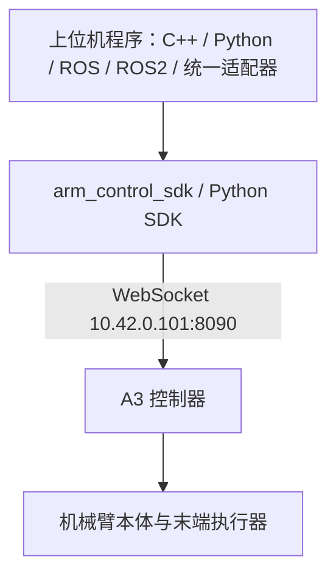
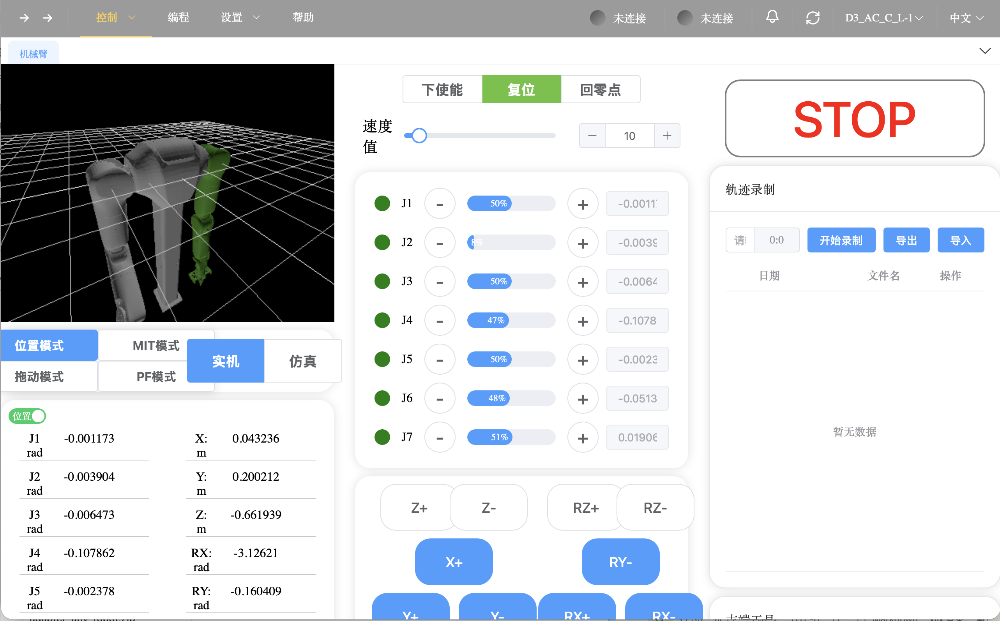

# CVTE CArm 使用手册

[首页](../../README.md) · [通用开发指南](../development.md)

[连接与编译](#连接与编译) · [一行命令验证](#一行命令验证) · [A3 单臂](#a3-单臂) · [D3 双臂](#d3-双臂) · [SDK 与统一接口](#sdk-与统一接口) · [架构与上位机界面](#架构与上位机界面) · [排错](#排错)

| 设备 | 配置与状态 |
|---|---|
| A3 单臂 | 6 个运动关节＋1 个夹爪，已做关节与夹爪现场测试 |
| D3 双臂 | 左右各 7 关节，支持状态读取、计划预检与小幅关节测试 |

## 连接与编译

二次开发程序运行在**上位机**，通过网络调用控制器，无需 SSH 登录机械臂。
网线连接后，先用 `ping 10.42.0.101` 检查连接；SDK 使用 WebSocket `10.42.0.101:8090`。D3 地址按实际设备修改。

从 [CVTE 文档中心](https://cvte-bot.feishu.cn/wiki/GyGbwKeWMiqEfDk80QXc9zeCnjf) 获取 SDK，解压到 `/opt/cvte/arm_control_sdk`。
本项目对接 C++ SDK `1.0.1`，按上位机 Linux 架构选择 ARM64 或 amd64 包。

```text
/opt/cvte/arm_control_sdk/
├── include/arm_control_sdk/   carm_cobot.h、carm_dual.h、data_type_def.h
├── lib/                      动态库与 cmake/arm_control_sdk
└── carm_python/              Python SDK
```

```bash
# C++ 接口检查程序
export BRIDGE_CVTE_SDK_DIR=/opt/cvte/arm_control_sdk
bash scripts/build_robot.sh carm

# Python 示例环境，Python ≥ 3.10
python3 -m venv .venv
source .venv/bin/activate
python -m pip install /opt/cvte/arm_control_sdk/carm_python
```

单臂和双臂共用一次构建，程序输出到 `build-cvte-only/`。Python SDK 通过 WebSocket 通信。

## 一行命令验证

先完成上面的 SDK 安装，在上位机项目根目录运行。默认 IP 为 `10.42.0.101`，可追加 `--ip 实际地址`。
状态检查自动编译 C++ 程序，单／双臂共用 `build-verify-carm/`；运动示例优先使用项目 `.venv` 中的 Python。

| 验证功能 | 一行命令 | 结果怎么看 |
|---|---|---|
| A3 连接与状态，只读 | `python3 scripts/verify_robot.py a3 state` | 6 关节，`valid=1 degraded=0 connected=1`，结果 `PASS` |
| A3 逐个测试 6 关节 | `python3 scripts/verify_robot.py a3 joints` | 每关节偏移 0.15 rad 并返回，目标和返回位置误差均不超过 0.05 rad |
| A3 只测试夹爪 | `python3 scripts/verify_robot.py a3 gripper` | 不发送关节运动，夹爪开合反馈误差不超过 0.005 m |
| A3 6 关节＋夹爪 | `python3 scripts/verify_robot.py a3 joint-gripper` | 上述两项依次完成，最终 `PASS` |
| D3 左右臂状态，只读 | `python3 scripts/verify_robot.py d3 state` | 默认共 14 关节，状态与连接健康，结果 `PASS` |
| D3 关节计划，只读 | `python3 scripts/verify_robot.py d3 plan` | 读取双臂状态与限位、打印计划，结果 `READ_ONLY_OK`，不执行运动 |
| D3 逐个测试 14 关节 | `python3 scripts/verify_robot.py d3 joints` | 核对起始姿态后，每关节偏移约 2° 并返回，结果 `PASS` |
| Python 示例离线回归 | `python3 scripts/verify_robot.py a3 offline` | SDK 替身测试显示 `OK`，不连接机器人 |

运动命令会显示计划，等待回车确认后执行。准备好急停，Ctrl+C 中止。`PASS` 只代表本次设定幅度与容差下的检查通过。
结果摘要保存在 `logs/verification/`。程序不自动清错或解除急停。

## A3 单臂

### 读取状态

```bash
./build-cvte-only/cvte_carm_check --model a3 --ip 10.42.0.101
python examples/cvte_carm/read_state.py --model a3 --ip 10.42.0.101
```

C++ 检查正常应显示 `joint_count=6 valid=1 degraded=0`、`connected=1`，退出码为 0。
Python 打印状态、关节位置和末端位姿。两者不使能或运动。

### 关节与夹爪演示

```bash
python examples/cvte_carm/joint_gripper_demo.py \
  --ip 10.42.0.101 --amplitude 0.15 --move-time 3
```

程序读取姿态与限位，展示计划并等待回车确认，然后调用 ready，逐个测试 6 关节并返回原位，最后测试夹爪。运行前清空运动范围并准备原厂急停。

| 参数 | 含义 |
|---|---|
| `--amplitude 0.15` | 单关节偏移，rad；第 3 关节取负方向 |
| `--move-time 3` | 每段运动秒数 |
| `--gripper-open 0.04` | 夹爪开口目标，米，受设备限位校验 |
| `--gripper-torque 5` | 夹爪命令的力／力矩限制参数，按设备手册校准 |
| `--skip-gripper` | 只测试关节 |
| `--only-gripper` | 只测试夹爪，不发送关节运动 |
| `--joint-tolerance 0.05` | 关节到位和返回反馈的最大绝对误差，rad |
| `--gripper-tolerance 0.005` | 夹爪到位反馈最大绝对误差，m |
| `--yes` | 跳过交互确认 |

输出每关节目标、反馈、返回误差和夹爪读数。Ctrl+C 尝试急停并断开，不自动回位或闭合夹爪；同步调用可能延迟中断处理，紧急情况使用原厂急停。
正常结束只断开连接，不自动关闭伺服。该运动脚本仅用于六关节 A3。

## D3 双臂

### 读取左右状态

```bash
./build-cvte-only/cvte_carm_check --model d3 --ip 10.42.0.101
python examples/cvte_carm/read_state.py --model d3 --ip 10.42.0.101
```

将 IP 换成实际控制器地址。配置按 14 个关节检查，期望 `joint_count=14 valid=1 degraded=0`、`connected=1`。
Python 分别输出 `left / right`；实际关节数不同应调整配置，不截断或补零。

### 关节计划预检

```bash
python3 scripts/verify_robot.py d3 plan
```

只读检查双臂状态、反馈更新、关节限位和目标计划，不发送运动请求。选择单侧或单个关节时，激活前述 `.venv` 后运行：

```bash
python examples/cvte_carm/dual_joint_demo.py --check
python examples/cvte_carm/dual_joint_demo.py --check --arm left --joints 1
```

`--check` 通过只表示状态与计划格式检查通过，不代表路径已完成运动验证。

### 小幅逐关节测试

```bash
python3 scripts/verify_robot.py d3 joints
```

先左臂 J1–J7，再右臂 J1–J7；幅度上限 0.035 rad（约 2°），每段至少 4 秒，段间额外等待为 0。按回车开始，Ctrl+C 尝试停止双臂并退出。

只测试单个关节：

```bash
python examples/cvte_carm/dual_joint_demo.py --enable-motion --arm left --joints 1 --amplitude 0.035 --move-time 4 --pause 0
```

起始姿态按 [D3 小幅测试配置](../../config/cvte_carm_d3.motion.json) 检查，双臂每个关节与参考值的偏差不超过 0.005 rad；不满足时退出，不自动移动到参考姿态。确认机身和周围物体均不在运动路径内再执行，姿态检查不具备防碰撞能力。
反馈过期、异常位移、实测关节速度超过 0.1 rad/s 或到位超时会尝试停止；失败或中断后不自动回位。

### 双臂调用与配置

```python
# 已创建并连接的 CArmDualBot 对象
left_q = robot.get_left_joint_pos()
right_q = robot.get_right_joint_pos()
left_status = robot.get_left_status()
right_status = robot.get_right_status()
```

| 范围 | 方法 |
|---|---|
| 左／右跟随 | `track_left_joint / track_right_joint` |
| 两侧跟随 | `track_joint(left_target, right_target)` |
| 左／右点到点 | `move_left_joint / move_right_joint` |
| 左／右末端 | `set_left_eeff / set_right_eeff` |
| 整机停止 | `emergency_stop` |

同控制器双臂使用 `CArmDualBot`；两台独立单臂使用两个 IP 和两个 `CArmSingleCol`。
先分别验证左右臂，再做双臂协同；ready、急停等整机方法可能影响两侧。

[双臂配置](../../config/cvte_carm_d3.sample.yaml) 的状态顺序为全部左臂关节、全部右臂关节。
`cvte_carm_d3_left / cvte_carm_d3_right` 提供单侧视图。C++ 配置使用 `Model::kD3Dual`，双侧选择 `ArmSelection::kBoth`，`arm_joint_count=7`。

## SDK 与统一接口

### 厂商接口对照

| 能力 | A3 `CArmSingleCol` | D3 `CArmDualBot` |
|---|---|---|
| 连接 | `connect / disconnect / is_connected` | 同名 |
| 就绪、急停 | `set_ready / emergency_stop` | 同名，整机生效 |
| 状态 | `get_status` | `get_left_status / get_right_status` |
| 位置 | `get_joint_pos` | `get_left_joint_pos / get_right_joint_pos` |
| 速度、力矩 | `get_joint_vel / get_joint_tau` | 对应 `get_left_* / get_right_*` |
| 末端位姿 | `get_cart_pose` | `get_left_cart_pose / get_right_cart_pose` |
| 伺服 | `set_servo_enable` | 同名，或 `set_left_servo_enable / set_right_servo_enable` |
| 模式 | `set_control_mode` | 同名，或 `set_left_control_mode / set_right_control_mode` |
| 位置跟随 | `track_joint(q)` | `track_joint(left, right)` 或单侧方法 |
| 点到点 | `move_joint` | `move_left_joint / move_right_joint` |
| 末端执行器 | `get_eeff_config / set_eeff` | 对应 `get_left_* / set_left_*` 与右侧版本 |

厂商命令成功通常返回 `1`。关节位置用 rad，速度用 rad/s；夹爪与工具参数以配套 SDK 为准。夹爪不计入机械臂关节数组。
逆解、轨迹、示教调用厂商 SDK，也可在上位机编写 ROS / ROS2 节点封装这些接口。

### 本项目适配器

公开头文件：[cvte_carm_adapter.hpp](../../include/bridge/adapters/cvte_carm/cvte_carm_adapter.hpp)。自定义 CMake 目标链接 `bridge_adapter_cvte_carm`。

适配器提供连接、关节位置／速度／力矩状态、健康查询、关闭，以及显式 ready、伺服、模式和急停。
`write_command` 支持关节位置跟随；夹爪、笛卡尔运动、逆解与示教使用厂商 SDK，通用速度／力矩命令返回 unsupported。

```cpp
#include "bridge/adapters/cvte_carm/cvte_carm_adapter.hpp"
using namespace bridge::adapters::cvte_carm;

CvteCarmAdapterConfig config;
config.session.server_ip = "10.42.0.101";
config.joint_names = {"joint_0", "joint_1", "joint_2", "joint_3", "joint_4", "joint_5"};
CvteCarmAdapter arm(config);
if (arm.initialize().succeeded()) {
  const auto result = arm.read_state();
  // 检查 result.result 和 result.state，再读取 joints.position。
}
const auto closed = arm.shutdown();
```

本项目用 `succeeded()` 判断结果，并检查状态的 `valid/stale/degraded`。初始化只连接，不自动 ready 或使能。
默认 CArm 构建不包含 DDS 桥接；需要时准备共享子模块并开启 `BUILD_BRIDGE_DDS=ON`，构建 `adapter_bridge`。
配置样例：[A3](../../config/cvte_carm_a3.sample.yaml)、[D3](../../config/cvte_carm_d3.sample.yaml)，默认禁用命令和状态通道。

## 架构与上位机界面



D3 使用相同部署方式，改用双臂 SDK 类和实际控制器地址。



图中为 D3 界面示例，可查看关节与末端位姿，操作关节、控制模式和轨迹录制。

## 排错

| 情况 | 检查 |
|---|---|
| ping 通但 SDK 连不上 | 控制器 IP、8090 端口、防火墙与客户端连接权限 |
| 状态空或关节数不符 | 型号、每侧 `arm_dof`、状态是否更新 |
| 返回成功但没有运动 | 是否仿真、模式与伺服、目标和反馈差异 |
| D3 只有一侧数据 | 分别检查左右连接、状态与供电 |
| D3 第一条运动报 `command rejected (-1)` | 查看终端 `SDK_REPLY` 和报告 `sdk_requests`；SDK 将拒绝或超时统一成 -1。先前执行过停止时，在原厂上位机确认现场并复位／恢复运行后重试；程序不自动解除停止状态 |
| D3 预检报 `invalid motion speed scale` | 原厂上位机确认停止状态已恢复、速度值非零；`vel_per=0` 表示速度倍率为零。程序不会自动提高速度 |
| 动态库加载失败 | SDK 路径、Linux 架构及配套 lib 文件 |
| Python 找不到 `carm` | 激活 `.venv` 并安装厂商包 |

官方资料：[SDK Demo](https://github.com/cvte-robotics/carm_demo)、[用户文档](https://cvte-bot.feishu.cn/wiki/GyGbwKeWMiqEfDk80QXc9zeCnjf)、[眼在手抓取示例](https://github.com/cvte-robotics/carm_grasp)。抓取另需相机、手眼和工具标定。
