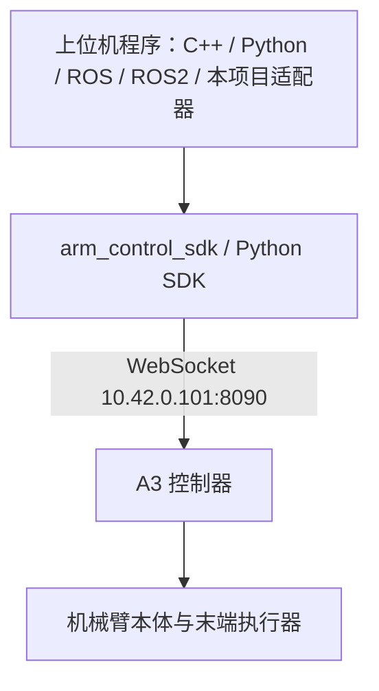

# CVTE CArm SDK 使用

[首页](../../README.md) · [单臂 A3](single-arm.md) · [双臂 D3](dual-arm.md)

CArm SDK 运行在控制电脑上，经网线访问控制器，**不需要 SSH 登录机械臂内部**。
已测试设备是 A3 单臂：6 个运动关节＋1 个夹爪。D3 双臂适配未做真机测试。

## 上位机与控制器的架构链路

**二次开发程序正常运行在上位机上，通过网络调用控制器接口。** 在上位机安装 SDK、编译本项目并运行程序即可；控制器负责驱动机械臂本体。



`10.42.0.101:8090` 是这里使用的 A3 控制器地址。D3 使用同样的上位机部署方式，换成实际控制器地址和双臂 SDK 类，分别处理左右臂。
SDK 包的架构应匹配**运行程序的上位机环境**：Linux ARM64 用 arm64 包，Linux x86_64 用 amd64 包。

上位机可以进行以下开发：

| 开发内容 | 调用入口 |
|---|---|
| 连接和状态读取 | SDK 的 `connect`、`is_connected`、`get_status`；或本项目的初始化、状态与健康查询 |
| 关节位置、速度、力矩读取 | SDK 的 `get_joint_pos`、`get_joint_vel`、`get_joint_tau`；统一适配器提供关节状态 |
| 运动控制 | SDK 的 `track_joint`、`move_joint` 等；统一适配器支持关节位置跟随 |
| 末端执行器控制 | SDK 的 `get_eeff_config`、`set_eeff` 等；夹爪示例见单臂操作页 |
| 逆运动学和轨迹控制 | 厂商 SDK 的逆解、运动与轨迹接口；按配套 SDK 签名调用 |
| ROS / ROS2 节点 | 在上位机编写节点封装 SDK，将状态发布为话题，将控制请求转换为 SDK 调用 |
| 本项目统一适配器 | 使用 `CvteCarmAdapter` 接入统一状态、位置命令和故障处理；需要 DDS 时再启用桥接构建 |

上表中的 ROS / ROS2 节点属于可扩展的开发方式，本仓库没有随 CArm 构建自动启动的 ROS 节点。具体接口范围见下方“本项目接口边界”。

### 上位机界面


图中为 D3 界面示例，可查看关节与末端位姿，操作关节、控制模式及轨迹录制。实际显示的关节数量随所选型号变化；已测试的 A3 为 6 个运动关节＋1 个夹爪。

## 1. 安装 SDK

从 [CVTE 文档中心](https://cvte-bot.feishu.cn/wiki/GyGbwKeWMiqEfDk80QXc9zeCnjf) 获取 SDK，解压到本机；有权限的账号可能需要登录。
当前代码对接 C++ SDK `1.0.1`。Linux ARM64 选 arm64 包，Linux Intel/AMD 选 amd64 包。文件不随仓库分发。

```text
/opt/cvte/arm_control_sdk/
├── include/arm_control_sdk/   carm_cobot.h、carm_dual.h、data_type_def.h
├── lib/                      SDK 动态库与 cmake/arm_control_sdk
└── carm_python/              Python SDK（如果厂商包包含）
```

C++ 只读程序：

```bash
export BRIDGE_CVTE_SDK_DIR=/opt/cvte/arm_control_sdk
bash scripts/build_robot.sh carm
```

Python 示例，使用 **Python ≥ 3.10**，优先安装随设备提供的 SDK：

```bash
python3 -m venv .venv
source .venv/bin/activate
python -m pip install /opt/cvte/arm_control_sdk/carm_python
```

Python 包通过 WebSocket 通信，依赖由 pip 从厂商包的 `pyproject.toml` 安装；不要把 C++ 动态库直接当 Python 模块导入。

## 2. 连接与返回值

控制电脑和控制器配置到同一网段；示例控制器为 `10.42.0.101:8090`，按现场实际地址修改。
`ping` 成功只证明 IP 连通，SDK 仍要检查连接、状态与关节维度。

- 本项目 `AdapterCallResult` 用 `succeeded()` 判断，并检查状态的 `valid/stale/degraded`。
- 厂商 CArm 命令成功通常返回 `1`；Python 示例按该版本的 `1` 判定；不要套用宇树的 `0` 成功约定。
- 关节位置使用 rad，关节速度使用 rad/s；末端参数、工具坐标与夹爪单位以对应厂商接口为准。
- 配置里的关节数量不包含夹爪。双臂状态按“全部左臂关节 → 全部右臂关节”拼接。

## 3. 单臂与双臂对应关系

| 能力 | A3 `CArmSingleCol` | D3 `CArmDualBot` |
|---|---|---|
| 连接／断开 | `connect / disconnect / is_connected` | 同名 |
| 就绪、整机急停 | `set_ready / emergency_stop` | 同名，作用于两侧 |
| 状态 | `get_status` | `get_left_status / get_right_status` |
| 关节位置 | `get_joint_pos` | `get_left_joint_pos / get_right_joint_pos` |
| 关节速度、力矩 | `get_joint_vel / get_joint_tau` | 对应 `get_left_* / get_right_*` |
| 末端位姿 | `get_cart_pose` | `get_left_cart_pose / get_right_cart_pose` |
| 伺服 | `set_servo_enable` | 整机同名，或 `set_left_servo_enable / set_right_servo_enable` |
| 控制模式 | `set_control_mode` | 整机同名，或 `set_left_control_mode / set_right_control_mode` |
| 位置跟随 | `track_joint(q)` | `track_joint(left, right)` 或 `track_left_joint / track_right_joint` |
| 点到点运动 | `move_joint` | `move_left_joint / move_right_joint`；双臂整体调用见对应 SDK 签名 |
| 末端执行器 | `get_eeff_config / set_eeff` | 对应 `get_left_eeff_config / set_left_eeff` 与右侧版本 |

同控制器双臂使用 `CArmDualBot`；两台独立单臂是两个 IP、两个 `CArmSingleCol`，不能混用。

## 4. 本项目接口边界

公开头文件：[cvte_carm_adapter.hpp](../../include/bridge/adapters/cvte_carm/cvte_carm_adapter.hpp)。

`CvteCarmAdapter` 提供 `initialize`、`read_state`、`query_health`、`shutdown`，以及显式 `set_ready`、`set_servo_enable`、`set_control_mode`、`emergency_stop`。
初始化只建立会话，不自动 ready 或开启伺服。
`write_command` 只支持关节位置模式，将位置向量传给 `track_joint`；速度、力矩、刚度、阻尼向量返回 unsupported。
笛卡尔运动、夹爪、逆解、示教等尚未封装到公共 adapter，使用配套厂商 SDK；不要把“厂商有 API”写成“框架已经实现”。

```cpp
#include "bridge/adapters/cvte_carm/cvte_carm_adapter.hpp"
using namespace bridge::adapters::cvte_carm;

CvteCarmAdapterConfig config;
config.session.server_ip = "10.42.0.101";
config.joint_names = {"joint_0", "joint_1", "joint_2", "joint_3", "joint_4", "joint_5"};
CvteCarmAdapter arm(config);  // 默认 A3 单臂
const auto opened = arm.initialize();
if (opened.succeeded()) {
  const auto result = arm.read_state();
  // 检查 result.result 和 result.state，再读取 joints.position。
}
const auto closed = arm.shutdown();
```

接入自己的 CMake 目标时链接 `bridge_adapter_cvte_carm`。
默认 CArm 构建不生成 DDS 主程序；确实需要通用桥接时，准备共享子模块后显式开启 `BUILD_BRIDGE_DDS=ON`，再构建 `adapter_bridge`。
`config/cvte_carm_*.sample.yaml` 默认禁用命令入口和状态出口，用于配置装配参考，不会自动把夹爪放入关节通道。

## 5. 排错

| 情况 | 检查 |
|---|---|
| ping 通，SDK 连不上 | 控制器 IP、8090 端口、防火墙、控制器是否允许当前客户端 |
| 读到空数组／维度不符 | 型号是否选错、状态是否到达、实际 `arm_dof`；先只读，不发送补零目标 |
| 命令返回成功但看不到运动 | 是否为仿真/debug、伺服与模式、实际目标与反馈差异 |
| D3 只有一侧数据 | 分别检查左右状态与供电；不要把整机连接成功当成两臂健康 |
| 动态库加载失败 | SDK 路径和 Linux 架构；保留 SDK 配套 lib 文件 |

官方例程：[carm_demo](https://github.com/cvte-robotics/carm_demo)；抓取扩展：[carm_grasp](https://github.com/cvte-robotics/carm_grasp)。抓取需要独立完成相机、手眼和工具标定，本仓库没有可直接启动的抓取系统。
